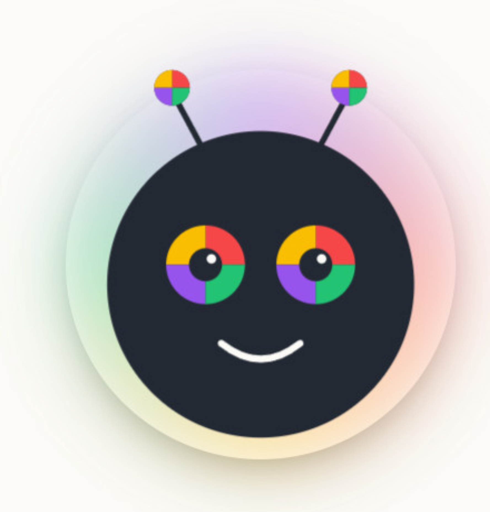
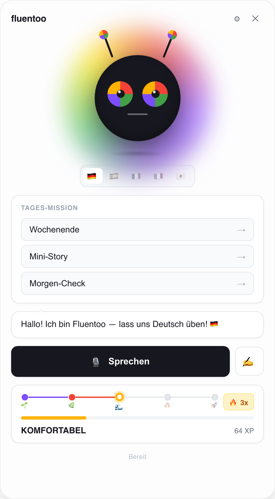
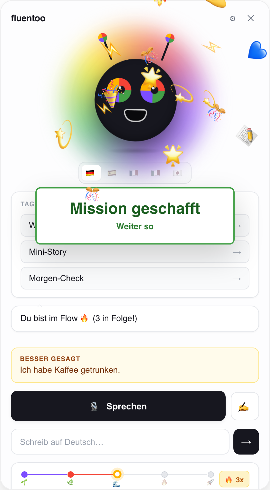
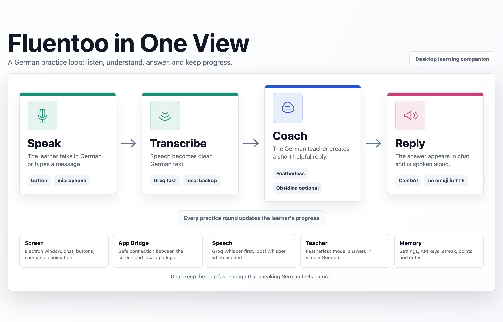
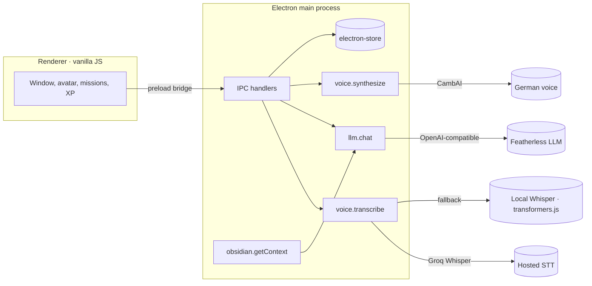

<p align="center">
  
</p>

<h1 align="center">Fluentoo</h1>

<p align="center">
  <b>A voice-first desktop companion for daily German speaking practice.</b><br/>
  Pick a two-minute mission, talk, get a warm reply in German and a gentle correction.
</p>

<p align="center">
  <a href="https://fluentoo.pages.dev"><b>Landing page</b></a> ·
  <a href="#how-it-works">How it works</a> ·
  <a href="#engineering-decisions">Engineering decisions</a> ·
  <a href="#run-it-locally">Run it locally</a>
</p>

<p align="center">
  
  &nbsp;&nbsp;
  
</p>

## Why

Apps teach vocabulary well. What they rarely train is *speaking*: forming a sentence out loud, getting it slightly wrong, and trying again without feeling judged. Fluentoo is built around that one habit. It sits on your desktop as a small always-on-top window, nudges you every 45 minutes, and keeps each round short enough that you actually do it.

## Features

- **Voice in, voice out.** Speak German, hear a natural German voice answer.
- **Daily missions.** Three short speaking prompts per day (Morgen-Check, Restaurant, Wochenende, Mini-Story). Any genuine attempt counts.
- **Gentle corrections.** Mistakes come back as *"Man sagt besser: …"* and are lifted into a separate "Besser gesagt" card.
- **Progression.** Five fluency stages (🌱 Schüchtern → 🚀 Fluentoo Level), XP, and a streak multiplier.
- **A character with moods.** The avatar laughs, smiles, gets excited or looks a bit sad depending on how the round went.
- **Your own vocabulary.** Point it at an Obsidian vault and your word lists flow into the tutor's context.

## How it works





1. **Speak**: the renderer records audio with `MediaRecorder` (or you type).
2. **Transcribe**: hosted Whisper on Groq when a key is set, otherwise on-device Whisper through `@huggingface/transformers` + ffmpeg.
3. **Coach**: an LLM tutor prompted for simple A2–B1 German, 2–3 sentences, no quizzing. During a mission it also judges the attempt.
4. **Reply**: CambAI speaks the answer in German; the browser's speech synthesis takes over if there's no key or the call fails.

## Engineering decisions

| Decision | Why |
| --- | --- |
| **Fallback at every external hop** | Hosted STT → local Whisper, CambAI → browser TTS. Only the LLM key is required, so the app works for anyone who clones it. |
| **Structured result line instead of JSON mode** | Mission replies end with `MISSION_RESULT: PASS\|FAIL`, which is parsed and stripped before display. A local word-count heuristic decides when the model forgets the line. Robust with small open models that don't reliably produce JSON. |
| **Correction extraction** | The tutor is asked to phrase fixes as *"Man sagt besser: …"*; the renderer extracts only the quoted phrase or first sentence into the correction card. |
| **Secure Electron defaults** | `contextIsolation: true`, `nodeIntegration: false`, a narrow `contextBridge` API in `preload.js`, and a Content-Security-Policy on the renderer. All network calls happen in the main process. |
| **No frontend framework** | The avatar, emotions and confetti are CSS (`conic-gradient` + keyframes). Small bundle, near-zero idle cost for an always-on window. |
| **Local-first state** | Progress, streak and settings live in `electron-store` on your machine. No account, no backend. |

## Tech stack

Electron 31 · Node.js · OpenAI-compatible SDK · Featherless (default `meta-llama/Llama-3.1-8B-Instruct`, configurable) · Groq Whisper · transformers.js Whisper · CambAI TTS · electron-store · vanilla HTML/CSS/JS

## Run it locally

```bash
git clone https://github.com/kaiser-data/fluento
cd fluento
npm install
cp .env.example .env   # add your keys
npm start
```

| Variable | Required | Purpose |
| --- | --- | --- |
| `FEATHERLESS_API_KEY` | yes | Tutor LLM |
| `FEATHERLESS_MODEL` | no | Any Featherless chat model |
| `GROQ_API_KEY` / `STT_API_KEY` | no | Fast hosted speech-to-text |
| `CAMB_API_KEY`, `CAMB_VOICE_ID` | no | Natural German voice |
| `OBSIDIAN_VAULT_PATH` | no | Pull your vocabulary notes into context |

Local speech-to-text needs `ffmpeg` on your `PATH`. On first launch macOS asks for microphone access.

```bash
npm run check      # syntax-check all sources
npm run site:dev   # preview the landing page (site/) locally
npm run site:deploy
```

## Project layout

```
main.js                 Electron main process, IPC handlers, reminders
preload.js              contextBridge API exposed to the renderer
src/modules/llm.js      Tutor prompt + conversation memory
src/modules/voice.js    STT (hosted → local Whisper) and TTS (CambAI)
src/modules/obsidian.js Reads vocabulary notes from an Obsidian vault
src/renderer/           Window UI: missions, emotions, XP, chat
site/                   Landing page, deployed to Cloudflare
docs/architecture.html  One-page architecture overview
```

## Status and roadmap

Built as a hackathon project and tested on macOS. German is the only active language; the other flags in the UI are placeholders.

- [ ] Spanish, French, Italian and Japanese tutors
- [ ] Packaged builds (electron-builder) for macOS and Windows
- [ ] Spaced repetition of past corrections
- [ ] Unit tests for mission parsing and progression logic

## Brand

**Warm · Curious · Precise · Patient.** Fluency is not memorised, it's inhabited.

## License

[MIT](LICENSE)
